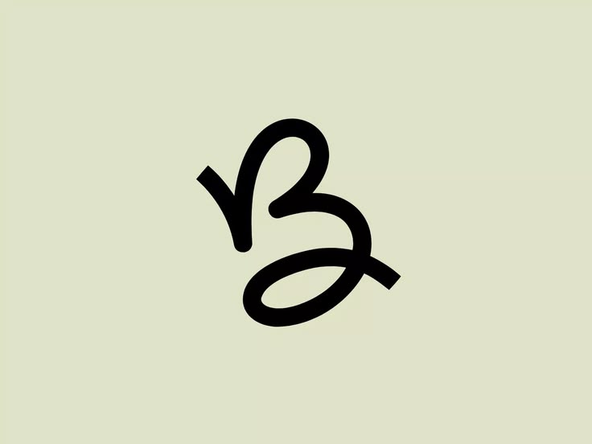

<p align="center">
  
</p>

# Breaky

A browser engine in Rust. Educational, experimental.

## Usage

```sh
cargo run -- page.html [style.css] [width] [out.png]
cargo run -- fetch http://example.com [width] [out.png]
```

Prints the DOM tree, the styled tree with cascaded properties and the box
layout. With an output path it also paints the page to a PNG.

## Architecture

Workspace of small crates:

- `breaky-html` — HTML tokenizer and DOM
- `breaky-css` — CSS parser
- `breaky-style` — selector matching and cascade
- `breaky-layout` — box tree and block/inline layout
- `breaky-render` — PNG painter (hand-written encoder, zero deps)
- `breaky-net` — HTTP client and URL resolution
- `breaky` — CLI

## Roadmap

- [x] HTML tokenizer
- [x] DOM builder
- [x] CSS parser
- [x] Style engine
- [x] Inheritance
- [x] Typed values
- [x] Layout
- [x] Margin collapsing
- [x] Percentages
- [x] Floats
- [x] Rendering
- [x] Text and fonts
- [x] Networking

## License

[MIT](LICENSE)
